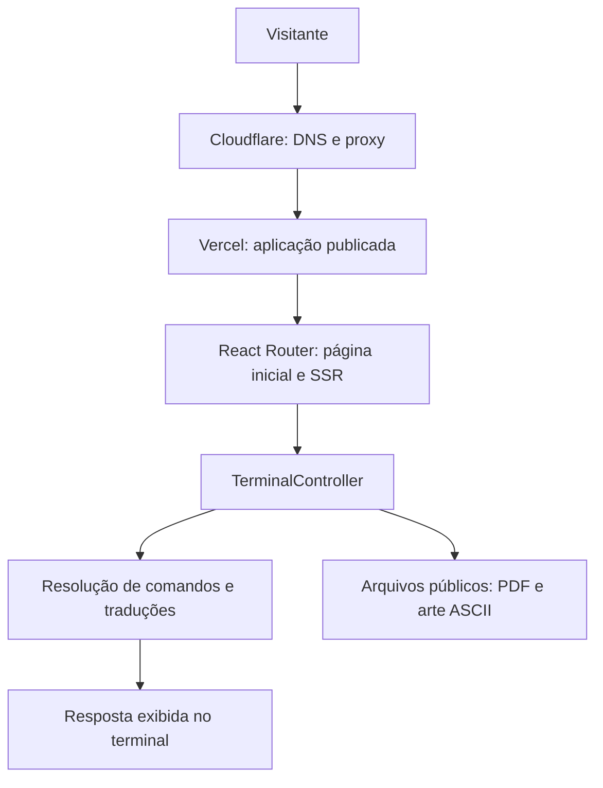

# 🏷️ Portfólio - Francisco Filipe 👨‍💻

> [!NOTE]
> Conheça minha trajetória como desenvolvedor Full Stack por meio de um terminal interativo, com conteúdo em português e inglês.

<table>
  <tr>
    <td>
      <p>Este portfólio reúne meus projetos, experiências profissionais, formação, habilidades e cursos em uma interface inspirada em um terminal. Visitantes podem explorar o conteúdo usando comandos, visualizar meu currículo e acessar meus contatos.</p>
    </td>
    <td width="140" align="center">
      
    </td>
  </tr>
</table>

---

## 🚧 Status do Projeto

**Publicado e em evolução.** O site está disponível na Vercel, com domínio próprio e Cloudflare como proxy e gerenciador de DNS.

[](https://franciscofilipeee.dev)


---

## 📚 Índice

- [Links Úteis](#-links-úteis)
- [Sobre o Projeto](#-sobre-o-projeto)
- [Funcionalidades Principais](#-funcionalidades-principais)
- [Tecnologias Utilizadas](#-tecnologias-utilizadas)
- [Arquitetura](#-arquitetura)
- [Instalação e Execução](#-instalação-e-execução)
- [Deploy](#-deploy)
- [Estrutura de Pastas](#-estrutura-de-pastas)
- [Demonstração](#-demonstração)
- [Testes](#-testes)
- [Documentações utilizadas](#-documentações-utilizadas)
- [Autores](#-autores)
- [Contribuição](#-contribuição)
- [Agradecimentos](#-agradecimentos)
- [Licença](#-licença)

---

## 🔗 Links Úteis

- **Aplicação publicada:** [franciscofilipeee.dev](https://franciscofilipeee.dev)
- **Repositório:** [franciscofilipeee/portfolio](https://github.com/franciscofilipeee/portfolio)
- **Currículo:** [Visualizar PDF](public/curriculo-francisco-filipe.pdf)

---

## 📝 Sobre o Projeto

O projeto foi criado para apresentar minha atuação profissional e os trabalhos dos quais participei. A proposta é oferecer uma experiência de navegação ligada ao universo do desenvolvimento: em vez de percorrer páginas convencionais, o visitante digita comandos para consultar cada assunto.

O conteúdo inclui projetos como Modfy Brasil, produtos da Brunsker e CSF, além de empresas em que trabalhei, tecnologias, formação e cursos. O suporte a dois idiomas permite compartilhar o portfólio com públicos de língua portuguesa e inglesa.

---

## ✨ Funcionalidades Principais

- Terminal com comandos e navegação pelo histórico usando as setas para cima e para baixo.
- Alternância entre português e inglês pelo botão no cabeçalho ou por comando.
- Perfil resumido no estilo `neofetch`, incluindo emprego atual.
- Projetos com descrições, tecnologias e links.
- Histórico profissional com empresas, períodos e atividades.
- Prévia e download do currículo em PDF.
- Listagem de cursos com instituição, período e carga horária.

---

## 🛠 Tecnologias Utilizadas

### 💻 Interface e desenvolvimento

- **React 19 e React DOM:** componentes, estado e renderização da interface.
- **React Router 8:** rotas e renderização no servidor (SSR).
- **TypeScript 5:** tipagem do código.
- **Tailwind CSS 4:** estilização.
- **Vite 8:** servidor de desenvolvimento e build.
- **react-terminal-ui:** interface e entrada de comandos do terminal.
- **Node.js e npm:** execução e gerenciamento de dependências.

### ⚙️ Infraestrutura e publicação

- **Docker e Docker Compose:** execução alternativa em contêiner.
- **Vercel:** hospedagem.
- **Cloudflare:** gerenciamento de DNS e proxy de `franciscofilipeee.dev`.

### 📦 Dependências e bibliotecas

As versões abaixo correspondem aos intervalos declarados no `package.json`. O `package-lock.json` registra as versões resolvidas para instalação com `npm ci`.

### Dependências de execução

| Pacote | Versão declarada | Finalidade |
| --- | --- | --- |
| `react` | `^19.2.7` | Construção da interface |
| `react-dom` | `^19.2.7` | Renderização do React |
| `react-router` | `^8` | Roteamento e recursos do framework |
| `@react-router/node` | `^8` | Integração do React Router com Node.js |
| `@react-router/serve` | `^8` | Servidor para execução do build local |
| `react-terminal-ui` | `^1.4.0` | Interface e entrada de comandos do terminal |
| `isbot` | `^5.1.36` | Biblioteca de identificação de bots incluída nas dependências |

### Dependências de desenvolvimento

| Pacote | Versão declarada | Finalidade |
| --- | --- | --- |
| `@react-router/dev` | `^8` | Build, desenvolvimento e geração de tipos de rotas |
| `vite` | `^8.0.3` | Servidor de desenvolvimento e empacotamento |
| `typescript` | `^5.9.3` | Verificação de tipos |
| `tailwindcss` | `^4.3.3` | Estilização |
| `@tailwindcss/vite` | `^4.3.3` | Integração do Tailwind CSS com Vite |
| `@types/node` | `^22` | Tipos do Node.js |
| `@types/react` | `^19.2.14` | Tipos do React |
| `@types/react-dom` | `^19.2.3` | Tipos do React DOM |

---

## 🏗 Arquitetura

A aplicação utiliza React Router em modo framework, com SSR habilitado. A página inicial monta o controlador do terminal, que interpreta comandos e apresenta o conteúdo definido em `app/i18n.ts`.

| Componente | Responsabilidade |
| --- | --- |
| `app/root.tsx` | Documento HTML, fontes, favicon e tratamento de erros |
| `app/routes/home.tsx` | Página inicial e metadados |
| `app/components/terminal.tsx` | Entrada, histórico, seleção de idioma e respostas |
| `app/components/help.tsx` | Listagem dos comandos |
| `app/i18n.ts` | Conteúdo em português e inglês e resolução dos aliases |
| `public/` | Currículo, arte ASCII e ícones |

O conteúdo fica no código e em arquivos estáticos. O histórico e o idioma ficam no estado React durante a sessão. Essa organização permite atualizar os dados do portfólio sem configurar banco de dados ou uma API própria.



---

## 🔧 Instalação e Execução

### Pré-requisitos

- **Node.js 24**, versão utilizada pelo Dockerfile do projeto. As dependências instaladas exigem Node.js a partir de **22.22.0**.
- **npm** e **Git**.
- Docker com Docker Compose, caso escolha executar em contêiner.

### Instalar

```bash
git clone https://github.com/franciscofilipeee/portfolio.git
cd portfolio
npm ci
```

### Iniciar em desenvolvimento

```bash
npm run dev
```

Acesse [http://localhost:5173](http://localhost:5173). Se a porta estiver ocupada, consulte o endereço informado no terminal.

A aplicação utiliza conteúdo definido no código e arquivos estáticos. Não é necessário configurar banco de dados ou variáveis de ambiente para executar localmente.

### Verificar os tipos

```bash
npm run typecheck
```

Esse comando gera os tipos das rotas e executa a verificação do TypeScript.

### Gerar e executar o build local

```bash
npm run build
npm run start
```

O build é gerado em `build/client` e `build/server`. O servidor local de produção utiliza a porta `3000` por padrão: [http://localhost:3000](http://localhost:3000).

### Executar com Docker Compose

```bash
docker compose up --build -d
```

Acesse [http://localhost:3000](http://localhost:3000). Para usar outra porta no host:

```bash
PORT=8080 docker compose up --build -d
```

Para encerrar os contêineres:

```bash
docker compose down
```

---

## 🚀 Deploy

**Endereço de produção:** [https://franciscofilipeee.dev](https://franciscofilipeee.dev)

| Serviço | Papel no ambiente publicado |
| --- | --- |
| Vercel | Hospedagem da aplicação |
| Cloudflare | DNS e proxy do domínio |
| `franciscofilipeee.dev` | Domínio de acesso ao portfólio |

Para gerar os artefatos localmente, execute `npm run build`. O React Router produz `build/client` e `build/server`; `npm run start` executa esse build em um servidor Node.js local. A publicação na Vercel utiliza a configuração do projeto no provedor.

O fluxo de acesso ao site é **navegador → Cloudflare → Vercel**. As informações de hospedagem e domínio desta seção refletem o ambiente informado pelo autor.

---

## 📂 Estrutura de Pastas

```text
portfolio/
├── app/
│   ├── components/
│   │   ├── help.tsx             # Lista de comandos disponíveis
│   │   └── terminal.tsx         # Terminal, histórico e respostas dos comandos
│   ├── routes/
│   │   └── home.tsx             # Página inicial e metadados
│   ├── app.css                  # Estilos globais e do terminal
│   ├── i18n.ts                  # Conteúdo, traduções e aliases dos comandos
│   ├── root.tsx                 # Estrutura HTML, recursos e tratamento de erros
│   └── routes.ts               # Configuração das rotas
├── public/
│   ├── ascii-art.txt            # Arte exibida pelo neofetch
│   ├── curriculo-francisco-filipe.pdf
│   ├── favicon.ico
│   └── favicon.svg              # Ícone </> da aplicação
├── Dockerfile                  # Build e execução em contêiner
├── docker-compose.yml          # Configuração do serviço Docker
├── package.json                # Dependências e scripts
├── package-lock.json           # Versões resolvidas das dependências
├── react-router.config.ts      # Configuração do framework com SSR
├── tsconfig.json               # Configuração do TypeScript
├── vite.config.ts              # Plugins e configuração do Vite
└── README.md
```

---

## 🎥 Demonstração

A demonstração está disponível em [franciscofilipeee.dev](https://franciscofilipeee.dev). Para explorar a aplicação:

1. Digite `help` para consultar os comandos.
2. Clique em **Português** no cabeçalho ou digite `language pt`.
3. Digite `projetos` para visualizar os projetos e suas tecnologias.
4. Digite `trabalhos` para consultar empresas, períodos e atividades.
5. Digite `curriculo` para visualizar ou baixar o PDF.

### 💻 Comandos disponíveis

Digite um comando e pressione **Enter**. O terminal aceita os aliases em português e inglês.

| Inglês | Português | Função |
| --- | --- | --- |
| `help` | `ajuda` | Listar comandos |
| `neofetch` | `neofetch` | Exibir resumo do perfil |
| `about` | `sobre` | Apresentar minha trajetória |
| `projects` | `projetos` | Listar projetos e tecnologias |
| `contact` | `contato` | Exibir contatos |
| `resume` | `curriculo` | Visualizar e baixar o currículo |
| `skills` | `habilidades` | Listar habilidades técnicas |
| `education` | `formacao` | Exibir formação acadêmica |
| `experiences` | `experiencias` | Exibir foco profissional |
| `work` | `trabalhos` | Listar empresas, períodos e atividades |
| `certifications` | `certificacoes` | Listar cursos |
| `language pt` / `language en` | `idioma pt` / `idioma en` | Alternar idioma |
| `clear` | `limpar` | Limpar o terminal |
| `exit` | `sair` | Solicitar fechamento da janela, sujeito à permissão do navegador |

---

## 🧪 Testes

O projeto possui verificação de tipos pelo TypeScript. Atualmente não há suíte de testes unitários, de integração ou E2E configurada.

```bash
npm run typecheck
npm run build
```

O primeiro comando gera os tipos das rotas e verifica o código; o segundo verifica a geração do build. Essas verificações não substituem testes de comportamento.

Para validar a interface manualmente, confira a troca de idioma, os aliases dos comandos, a navegação pelo histórico, a limpeza do terminal, os links dos projetos e a visualização e download do currículo em telas de computador e celular.

---

## 🔗 Documentações utilizadas

Referências técnicas das ferramentas presentes no projeto:

- [React](https://react.dev/)
- [React Router](https://reactrouter.com/)
- [TypeScript](https://www.typescriptlang.org/docs/)
- [Vite](https://vite.dev/guide/)
- [Tailwind CSS](https://tailwindcss.com/docs)
- [react-terminal-ui](https://www.npmjs.com/package/react-terminal-ui)
- [Docker](https://docs.docker.com/)
- [Vercel](https://vercel.com/docs)
- [Cloudflare](https://developers.cloudflare.com/)

---

## 👥 Autores

| Nome | GitHub | LinkedIn |
| --- | --- | --- |
| Francisco Filipe da Cunha Oliveira | [franciscofilipeee](https://github.com/franciscofilipeee) | [Francisco Filipe](https://www.linkedin.com/in/franciscofilipeee/) |

---

## 🤝 Contribuição

Sugestões e relatos de problemas podem ser enviados pelas [issues do repositório](https://github.com/franciscofilipeee/portfolio/issues).

Para propor alterações:

1. Faça um fork do repositório e crie uma branch para a alteração.
2. Implemente a mudança e atualize as duas traduções quando houver conteúdo novo.
3. Execute `npm run typecheck` e `npm run build` e confira o comportamento no navegador.
4. Abra um pull request com a descrição e as verificações realizadas.

---

## 🙏 Agradecimentos

A estrutura desta documentação foi adaptada do [template de README do Prof. Dr. João Paulo Aramuni](https://github.com/joaopauloaramuni/desenvolvimento-e-integracao-de-aplicacoes-web/blob/main/TEMPLATES/template_README.md).

---

## 📄 Licença

O repositório ainda não possui um arquivo `LICENSE` com uma licença de distribuição definida.
